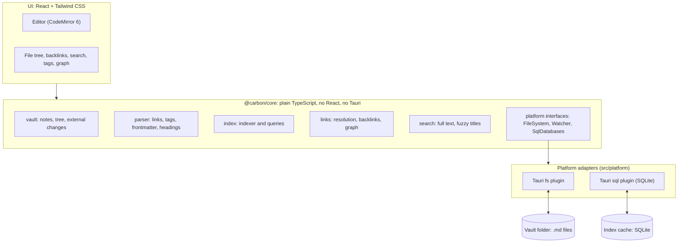

# Architecture

This document describes how Carbon is built and why. It is a living document: decisions are recorded in the [decision log](#12-decision-log) and open points in [open questions](#13-open-questions).

## 1. Goals and constraints

**Goals**

- Feel instant on vaults with 10,000+ notes.
- Notes are plain Markdown files. The app adds no lock-in.
- One codebase for every platform. Linux comes first, then Windows. Android, macOS and iOS must stay possible without a rewrite.
- Simple to use without plugins.

**Constraints**

- No Electron.
- TypeScript only for now. No custom Rust code.
- Solo developer: prefer boring, well-documented tools and a small surface area.
- The core must not depend on React or Tauri, so it can be tested alone and the shell can be replaced later.

**Performance budgets (targets to validate with benchmarks, 10k-note vault)**

| Metric                                         | Target                              |
| ---------------------------------------------- | ----------------------------------- |
| App start to interactive (index already built) | < 1 s                               |
| First full index                               | < 10 s                              |
| Reindex after saving one note                  | < 50 ms                             |
| Full-text search response                      | < 50 ms                             |
| Quick switcher response                        | < 16 ms                             |
| Typing                                         | no dropped frames (16 ms per frame) |
| Idle memory                                    | < 250 MB                            |

These numbers started as guesses. The two M0 measurements (file read speed and index write speed) are in [section 7](#7-tauri-usage). They leave room in every budget they touch, so the targets stand.

## 2. High-level overview



Everything runs inside the Tauri WebView. Tauri itself is used as a thin native layer through its official plugins.

| Layer             | Responsibility                                        | Knows about                      |
| ----------------- | ----------------------------------------------------- | -------------------------------- |
| UI                | Rendering, editor state, user interaction             | The public API of `@carbon/core` |
| Core              | Everything about notes: parsing, index, links, search | Only its own platform interfaces |
| Platform adapters | Implement the interfaces with Tauri plugins           | Tauri APIs                       |
| Tauri shell       | Window, native file access, SQLite                    | Nothing in Carbon                |

Two rules:

1. **The core never imports React or `@tauri-apps/*`.** It asks for a `Platform` object and uses only that.
2. **UI components never call Tauri APIs directly.** They call the core.

Why this matters: the core can be tested with `bun test` using a fake file system, and if a hot path ever needs native speed, only one adapter changes.

## 3. Repository layout

```
carbon/
  package.json              # the Carbon application and Bun workspaces root
  packages/
    core/                   # @carbon/core
      src/
        platform/           # interfaces: FileSystem, Watcher, SqlDatabases, Trash, SettingsStore
        vault/              # open vault, read/write, tree, external changes
        parser/             # links, tags, frontmatter, headings, plain text
        index/              # schema, indexer, startup scan
        links/              # resolution, backlinks, rename, graph queries
        search/             # full-text queries, fuzzy title matching
        config/             # vault and app settings
        index.ts            # public API
      test/
        fakes/              # in-memory platform (file system, watcher, SQLite, trash) for tests
  src/                      # the Carbon application: one Tauri project for all platforms
    features/               # editor, file-tree, backlinks, search, tags, graph, settings
    shells/
      desktop/              # desktop layout: sidebars, tabs, panels
    platform/               # Tauri implementations of the core interfaces
    workers/                # parsing worker
    dev/                    # dev builds only: measurements, style preview
  tauri/                    # Tauri: config, capabilities, plugin registration, small commands
```

- The application lives in the repository root, not in a separate `app/` folder. There is only one app, so the root `package.json` is both the app package and the workspaces root.

- This is one repository: `hexlabelposition/carbon`. There are no separate repositories per platform, because Tauri builds every target from the same project.
- `@carbon/core` is a private workspace package. It is not published to npm, so the name only matters inside the repository.
- A separate repository is justified only for something that lives on its own, such as a sync server or a website.
- The Tauri folder is named `tauri/` instead of the default `src-tauri/`. The Tauri CLI finds it by the `tauri.conf.json` inside, so the name is free. The scaffold creates `src-tauri/`; it is renamed once in M0.

## 4. Data model

### 4.1 Vault on disk

A vault is a folder. Carbon reads every `.md` file under it.

```
my-vault/
  Inbox.md
  projects/
    Carbon.md
  attachments/
    diagram.png
  .carbon/
    config.json             # vault settings that should travel with the vault
```

- `.carbon/` holds only small, human-readable settings.
- The **index database is not stored in the vault**. It lives in the app cache directory, keyed by vault path. Reason: sync tools (git, Syncthing, cloud drives) would otherwise sync a binary database and create conflicts.
- Hidden folders are ignored by the indexer.

### 4.2 Markdown flavor

- CommonMark + GFM (tables, task lists, strikethrough)
- Wiki links: `[[Note]]`, `[[Note|alias]]`, `[[Note#Heading]]`
- Regular Markdown links to local `.md` files count as links too
- Tags: `#tag`, nested `#area/topic`, and `tags:` in frontmatter
- YAML frontmatter: `tags`, `aliases`, plus arbitrary properties

### 4.3 Index schema (sketch)

```sql
notes(id INTEGER PRIMARY KEY, path TEXT UNIQUE, title TEXT,
      mtime INTEGER, size INTEGER, hash TEXT)

links(source_id INTEGER, target_raw TEXT, target_id INTEGER NULL,
      alias TEXT NULL, fragment TEXT NULL, pos_start INTEGER, pos_end INTEGER)

tags(id INTEGER PRIMARY KEY, name TEXT UNIQUE)
note_tags(note_id INTEGER, tag_id INTEGER)

aliases(note_id INTEGER, alias TEXT)
properties(note_id INTEGER, key TEXT, value TEXT)
headings(note_id INTEGER, level INTEGER, text TEXT, pos INTEGER)

notes_fts  -- FTS5 virtual table over title and body
```

`links.target_id` is `NULL` for unresolved links (the target note does not exist yet). Backlinks are a query on `links` by `target_id`. Each link also keeps a snippet, the plain text of the paragraph, heading or table row around it, so listing backlinks reads no files.

### 4.4 Note identity and link resolution

- A note is identified by its path relative to the vault root.
- `[[Name]]` resolves in this order: exact path match, then file name match anywhere in the vault (shortest path wins), then alias match.
- A wiki link with a folder, `[[folder/Name]]`, matches only the exact path from the vault root. A Markdown link, `[text](../Name.md)`, matches only its path relative to the note.
- Matching ignores case (in every language) and the Unicode normalization form.
- The index keeps the resolved target in `links.target_id`. When a note is added, removed or indexed again, only the links whose path or name keys could match it are resolved again.
- Renaming or moving a note or folder through Carbon rewrites links in the notes that point to it, and Markdown links inside the moved notes. A wiki link keeps its form: a bare name stays a name while it still finds the note, otherwise it becomes the path from the vault root. Links resolved through an alias are left as they are. A link to another note that the moved note now takes over by name (a shorter path with the same file name) is not changed.
- Renames done outside Carbon are seen as delete + create; links become unresolved until fixed.

## 5. Core modules

### platform (interfaces)

The only way the core touches the outside world.

```ts
interface FileSystem {
  readText(path: string): Promise<string>;
  writeTextAtomic(path: string, content: string): Promise<void>;
  list(dir: string): Promise<Entry[]>;
  stat(path: string): Promise<Stat>;
  exists(path: string): Promise<boolean>;
  mkdir(path: string): Promise<void>;
  rename(from: string, to: string): Promise<void>;
  remove(path: string, options?: { recursive?: boolean }): Promise<void>;
}

interface Watcher {
  watch(dir: string, onEvent: (e: FsEvent) => void): Promise<() => void>;
}

interface SqlDatabases {
  // a database file in the app cache directory
  open(name: string): Promise<SqlDatabase>;
}

interface SqlDatabase {
  execute(sql: string, params?: SqlValue[]): Promise<void>;
  select<Row>(sql: string, params?: SqlValue[]): Promise<Row[]>;
  close(): Promise<void>;
}

interface NoteParser {
  // optional: parses and hashes a batch of notes, in a Web Worker in the app
  parse(files: NoteFile[]): Promise<ParsedFile[]>;
}
```

The SQL of the index lives in the core (`index/`), behind the domain-shaped `IndexStore` class: the rest of the core and the UI see notes and links, not SQL. The platform only runs statements, so the schema and the queries are tested with `bun test` on Bun's SQLite in memory (ADR-021).

### vault

- Opens a folder, builds the tree, reads and writes notes.
- **Atomic writes:** write to a temp file, then rename over the original. A crash never leaves a half-written note.
- Subscribes to the watcher, debounces events, turns them into `added / changed / removed`.
- Ignores its own writes so a save does not trigger a reload.
- Checks a content hash before writing, so an external change is never silently overwritten.

### parser

- A pure function: `parseNote(text) => { title, headings, links, tags, frontmatter, plainText }`.
- Built on Lezer Markdown (`@lezer/markdown`), the same parser CodeMirror uses, with small extensions for wiki links and tags.
- **One grammar for both the editor and the index.** What the editor highlights as a link is exactly what the index stores as a link.
- Frontmatter is parsed with a YAML library.
- No DOM access, so it runs in a Web Worker and in tests.

### index

- **Startup scan:** list the vault, compare `mtime` and `size` with the index, reparse only what changed, drop entries for missing files.
- **Incremental update:** on save or watcher event, reparse one note and replace its rows.
- Schema version is stored in the database. On mismatch the index is deleted and rebuilt. No migrations needed because the index is a cache.

### links

- Link resolution, backlinks with context snippets, unresolved links, rename refactoring.
- Graph queries: whole vault, or local graph around one note with depth N.

### search

- Full text: SQLite FTS5 with snippets and ranking.
- Quick switcher: fuzzy matching over titles and aliases kept in memory (candidates: uFuzzy, fuzzysort).

### config

- App settings (recent vaults, last opened note, theme) in the app config directory, through the `SettingsStore` interface.
- Vault settings in `.carbon/config.json`.

## 6. Public API and events

The UI talks to the core through one object. Sketch:

```ts
const vault = await Vault.open(path, platform)

vault.tree()
vault.notes.read(path)
vault.notes.write(path, content, baseHash)
vault.notes.create(path) / rename(from, to) / remove(path)
vault.folders.create(path) / rename(from, to) / remove(path)
vault.attachments.read(path) / save(name, bytes) / import(source) / find(note, target)

vault.links.backlinks(path) / outgoing(path) / unresolved() / suggest(prefix)
vault.search.query(text) / titles(text)
vault.tags.list() / notes(tag)
vault.graph.global() / local(path, depth)

vault.on('changed', ...)        // file added, changed or removed outside the editor
vault.on('index:progress', ...)
vault.on('index:ready', ...)
vault.on('tree', ...)           // the app itself added, moved or deleted something
vault.on('conflict', ...)       // open note changed on disk while it has unsaved edits
```

- Types are ordinary shared TypeScript types. No code generation.
- All methods are async and never block the UI thread for long.

## 7. Tauri usage

Carbon uses Tauri as a native layer through official plugins. `tauri/` contains what the Tauri CLI generates (config, capabilities, plugin registration lines) and the few custom commands listed below.

| Need                                   | Plugin                                                 |
| -------------------------------------- | ------------------------------------------------------ |
| Read, write, list, rename, watch files | `fs` (file watching needs its `watch` feature enabled) |
| SQLite index                           | `sql` with the `sqlite` feature                        |
| Pick a vault folder                    | `dialog`                                               |
| Keep access to picked folders          | `persisted-scope`                                      |
| Open external links                    | `opener`                                               |
| App settings                           | `fs`: `settings.json` in the app config directory      |
| Updates (later)                        | `updater`                                              |
| Move to the system trash               | no plugin: the `move_to_trash` command (ADR-019)       |
| Copy a dropped file into the vault     | no plugin: the `import_file` command (ADR-020)         |

**M0 measurements**

Measured on 2026-11-11 on the author's Linux machine, with `bun tauri dev --release` and a generated vault (`bun gen:vault`): 10,000 notes, 19.4 MB, about 50,000 links. The measurement panels live in `src/dev/bench` and are shown in the dev panel of the shell.

_Reading files through the `fs` plugin (C-007)._ Each read is one call across the WebView bridge.

| Step                                 | Time            |
| ------------------------------------ | --------------- |
| List all folders (251), 16 at a time | 27 to 52 ms     |
| Read all notes, 1 at a time          | about 2,000 ms  |
| Read all notes, 4 to 32 at a time    | 660 to 1,100 ms |
| Read all notes, 64 to 256 at a time  | 610 to 710 ms   |

- Concurrency helps up to about 64 reads in flight and is flat beyond that. The startup scan uses 64.
- A full read of the vault costs well under a second, and later starts read only changed files.

_SQLite through the `sql` plugin (C-008)._ SQLite 3.46.0 with FTS5 available. One run fills `notes`, `links` and the FTS5 table.

| Rows per `INSERT` | Journal `delete`, 10k notes | Journal `wal`, 10k notes  |
| ----------------- | --------------------------- | ------------------------- |
| 1                 | about 558 s (extrapolated)  | about 94 s (extrapolated) |
| 50                | 6.6 s                       | 3.2 s                     |
| 200               | 2.4 s                       | 1.5 s                     |
| 1,000             | 1.1 s                       | 0.9 s                     |

| Query on the full index (WAL)           | Time       |
| --------------------------------------- | ---------- |
| Full-text search, 20 best hits          | 4 to 9 ms  |
| Backlinks of one note                   | under 1 ms |
| Reindex one note (3 deletes, 3 inserts) | 10 ms      |

- The search numbers are a worst case: in the generated vault every word occurs in almost every note, so all 10,000 notes match and are ranked.
- The plugin has no transaction API and uses a connection pool, so every statement is its own transaction. Row-by-row writes are unusable. Multi-row `INSERT` statements are fast.

**What follows for the index store**

- The database runs in WAL mode. The setting is stored in the database file, so it is set once at creation.
- Bulk writes use multi-row `INSERT` statements of up to 1,000 rows.
- Replacing one note takes several statements and is not atomic. A crash in between can leave that one note half indexed. This is acceptable because the index is a cache: the startup scan repairs it. If it ever hurts, "apply a batch in one transaction" is a small Rust command behind `SqlDatabase`.

**Native code policy**

- Carbon starts with zero custom native code. The exceptions are `move_to_trash` (ADR-019) and `import_file` (ADR-020): no official plugin can do either, so each is a few lines of Rust.
- Rust is introduced gradually: one small Tauri command at a time, only where a measurement shows a real need, and always behind a platform interface. Nothing else in the app changes. First candidate: "scan folder and return changed files in one call".
- Go or other languages are not embedded in the app as a sidecar. A sidecar means a second process, a second bridge on top of the WebView bridge, a separate binary per platform, and no clear path to mobile.
- Go remains a good choice for separate services, such as a future sync server.

## 8. UI

### Structure

- React + TypeScript + Vite, styled with Tailwind CSS.
- Feature folders: `editor`, `file-tree`, `backlinks`, `search`, `tags`, `graph`, `settings`.
- State: a small store for app state (open vault, open notes, panels). Core data is fetched through the core API and refreshed on core events.
- Long lists (file tree, search results) are virtualized.
- Theme: dark and light, built on CSS variables that Tailwind reads. Default palette: graphite and silver tones.

### Shells

Desktop and phone layouts differ too much to stretch one layout over both. Carbon shares everything that does not depend on screen size and keeps the layout separate.

| Part                                           | Shared?                               |
| ---------------------------------------------- | ------------------------------------- |
| Core (`@carbon/core`)                          | Fully shared                          |
| Feature logic (hooks, state, data loading)     | Shared                                |
| Small components (buttons, list items, inputs) | Shared, adapted with Tailwind         |
| Shell (how panels and navigation are arranged) | One per form factor, in `src/shells/` |

- Only the desktop shell exists for now. A mobile shell is an idea, not a plan.
- A shell decides which features it mounts. A reduced mobile feature set needs no conditions scattered through the code.

Three rules that keep a second shell cheap:

1. Feature logic never lives inside layout components.
2. Components do not rely on mouse and hover as the only way to do something.
3. No hard-coded panel widths in logic. Sizes are relative.

### Threads

- **Main thread:** UI, editor, calls to Tauri plugins.
- **Parsing worker:** runs `parseNote` for batches of files during the startup scan, so indexing never freezes typing.
- **Graph worker:** force layout.

### Editor

- CodeMirror 6 with the Markdown language package and Carbon's Lezer extensions.
- **Live preview** is built with CodeMirror decorations: syntax marks are hidden and formatting is shown when the cursor is outside the element, raw Markdown is shown when the cursor is inside it.
- The document on disk is always plain Markdown.
- Save flow: edits are debounced, then `vault.notes.write(path, content, baseHash)`. The core rejects the write if the file on disk no longer matches `baseHash`, which triggers the conflict flow.
- `[[` opens autocomplete backed by `vault.links.suggest`.

### Graph

- The core returns nodes and edges. Rendering happens on canvas or WebGL, not in the DOM.
- Renderer choice is an open question.

## 9. Key flows

**Open vault**

1. UI calls `Vault.open(path, platform)`.
2. Core lists the tree and returns. The UI is usable.
3. Core runs the startup scan in the background: changed files are read, parsed in the worker, written to the index. Emits `index:progress`, then `index:ready`.
4. Features that need the index (search, backlinks, graph) show a loading state until `index:ready`.

**Edit and save**

1. User types. CodeMirror updates locally.
2. After a short pause, UI calls `vault.notes.write`.
3. Core writes atomically, reparses the note, updates the index.
4. Core emits an event so backlinks, tags and graph refresh.

**External change**

1. Watcher reports a change, core debounces and reindexes the file.
2. If the note is open and clean, the editor reloads it.
3. If the note is open with unsaved edits, UI gets `conflict` and asks the user which version to keep.

**Rename**

1. UI calls `vault.notes.rename(old, new)`.
2. Core renames the file, finds all notes linking to it, rewrites those links, reindexes the affected notes.

## 10. Cross-platform, security, privacy

| Order | Platform   | WebView                   | Status                                        |
| ----- | ---------- | ------------------------- | --------------------------------------------- |
| 1     | Linux      | WebKitGTK                 | Primary. Developed and tested here every day  |
| 2     | Windows    | WebView2 (Chromium based) | Planned for v0.1, tested before release       |
| later | Android    | Android System WebView    | Under consideration, first in line after v0.1 |
| later | macOS, iOS | WKWebView                 | Under consideration, no hardware to test on   |

- Each platform uses a different browser engine. CSS and editor behavior must be tested on every supported platform.
- Android would need three things the desktop does not: a mobile shell, a `FileSystem` adapter for the app sandbox, and sync.
- No network access in v0.1. No telemetry, no account.
- Tauri capabilities are limited to the plugins listed above. File access is scoped to the opened vault and the app's own config and cache directories.
- Strict Content Security Policy. Remote content in notes (images from the web) is off by default.

## 11. Testing and quality

- **Core:** `bun test` with in-memory fakes for `FileSystem` and `SqlDatabases` (Bun's SQLite, in memory). Fixture vaults for link resolution and rename.
- **Parser:** a shared corpus of Markdown samples with expected links and tags, used by both parser tests and editor tests.
- **Benchmarks:** a generator creates vaults with N notes, links and tags. Results are compared with the budgets in section 1.
- **UI:** component and logic tests. The runner is not chosen yet (open question 7). End-to-end tests are added before 0.1.
- **CI:** type check, lint, tests, and a build on Linux and Windows.

## 12. Decision log

| ID      | Decision                                                                                                  | Status                     | Why                                                                                                                                                                                         |
| ------- | --------------------------------------------------------------------------------------------------------- | -------------------------- | ------------------------------------------------------------------------------------------------------------------------------------------------------------------------------------------- |
| ADR-001 | Core logic in a standalone TypeScript library (`@carbon/core`). Replaces the earlier plan of a Rust core  | Accepted                   | One language for the whole app, fastest route to MVP, parser shared with the editor. Rust stays possible for hot paths behind the platform interfaces                                       |
| ADR-002 | Tauri 2 as the desktop shell, used through official plugins only                                          | Accepted                   | System WebView means small binaries and lower memory than Electron. No custom Rust needed                                                                                                   |
| ADR-003 | Markdown files are the source of truth, the index is a rebuildable cache                                  | Accepted                   | No lock-in, works with git and other editors                                                                                                                                                |
| ADR-004 | React + TypeScript for the UI                                                                             | Accepted                   | Known stack, largest ecosystem                                                                                                                                                              |
| ADR-005 | CodeMirror 6 with live preview                                                                            | Accepted                   | Proven for Markdown live preview, keeps files as clean Markdown                                                                                                                             |
| ADR-006 | No built-in sync in v0.1                                                                                  | Accepted                   | A vault is a folder, external tools already work                                                                                                                                            |
| ADR-007 | MIT license                                                                                               | Accepted                   | Simple, familiar, maximum freedom for users and contributors                                                                                                                                |
| ADR-008 | Index stored outside the vault, in the app cache directory                                                | Accepted                   | Avoids sync conflicts on a binary file                                                                                                                                                      |
| ADR-009 | SQLite with FTS5 for index and search, behind the `IndexStore` interface (refined by ADR-021)             | Accepted                   | One engine for links, tags and search. Confirmed by the M0 measurements: FTS5 is available, 10k notes are indexed in about 1 s (section 7)                                                  |
| ADR-010 | Tailwind CSS for styling                                                                                  | Accepted                   | Fast to build UI with                                                                                                                                                                       |
| ADR-011 | Bun as package manager and script runner. `bun test` runs the core tests; the UI test runner is open      | Accepted, test runner open | One fast tool. Fall back to another tool only where Bun does not work. See open question 7                                                                                                  |
| ADR-012 | One Markdown grammar (Lezer) shared by editor and index                                                   | Accepted                   | No drift between what is shown and what is indexed                                                                                                                                          |
| ADR-013 | Obsidian vault compatibility is not a goal for v0.1                                                       | Accepted                   | Keeps scope small. Listed under ideas                                                                                                                                                       |
| ADR-014 | One monorepo with one Tauri project for all platforms                                                     | Accepted                   | Tauri builds every target from one project. Core and UI change in one commit. One CI and one issue list for a solo developer                                                                |
| ADR-015 | Platform order: Linux, then Windows for v0.1. Android, macOS and iOS are ideas                            | Accepted                   | Carbon solves its author's own needs first. No hardware to test Apple platforms                                                                                                             |
| ADR-016 | Shared feature logic, separate layout shell per form factor                                               | Accepted                   | Layouts differ too much to share, logic does not                                                                                                                                            |
| ADR-017 | Native code is added gradually as small Rust commands behind platform interfaces. No Go sidecar           | Accepted                   | Keeps one process and one bridge. Lets Rust be learned in small, isolated steps                                                                                                             |
| ADR-018 | ESLint for linting, Prettier for formatting                                                               | Accepted                   | The standard, well-documented pair. ESLint also enforces the import rules from section 2: no Tauri outside `src/platform`, no React or Tauri in core                                        |
| ADR-019 | Deleting moves to the system trash through one custom Rust command (`move_to_trash`, the `trash` crate)   | Accepted                   | No official Tauri plugin has a trash. A deleted note must be recoverable, and a trash folder inside the vault would be synced and indexed                                                   |
| ADR-020 | Files dropped from outside the vault are copied in by a custom Rust command (`import_file`)               | Accepted                   | On Linux the WebView gives a dropped file as a path, not as content, and the `fs` plugin may not read outside the opened folders. The command only writes new files inside an opened folder |
| ADR-021 | The SQL of the index lives in the core; the platform provides only `SqlDatabases` (open, execute, select) | Accepted                   | The schema and queries are the riskiest part of the index and must be tested; in the core they run on Bun's SQLite in `bun test`. The engine stays replaceable behind `IndexStore`          |

## 13. Open questions

1. **Index engine.** Resolved in M0: SQLite with FTS5 through the `sql` plugin (ADR-009, measurements in section 7). An in-memory index stays possible behind `IndexStore` but is not planned. The SQL lives in the core (ADR-021).
2. **Graph renderer.** Candidates: sigma.js, Pixi.js with d3-force, custom canvas. Decide with a 10k-node prototype.
3. **State management.** Zustand or plain React context plus a query cache.
4. **Stable note IDs.** Path-based identity is simple but loses links on external renames. Option: detect renames by content hash.
5. **Native hot paths.** At what measured numbers is it worth adding a Rust command (see section 7)?
6. **Income model.** The app stays free under MIT. Optional paid services (hosted sync, publishing) are an idea, not a plan.
7. **Test runner.** `bun test` or Vitest. The core is plain TypeScript and runs on `bun test` today. Vitest may suit UI tests better: its browser mode runs CodeMirror in a real engine, and it reuses the Vite config. Options: keep `bun test` everywhere, use Vitest only for `src/`, or move everything to Vitest. The test APIs are nearly identical, so switching later is cheap.
