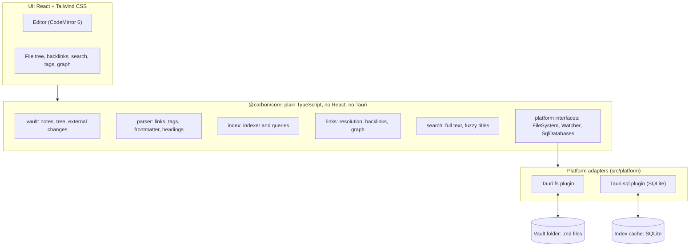

# Architecture

This document describes how Carbon is built and why. It is a living document: decisions are recorded in the [decision log](#12-decision-log) and open points in [open questions](#13-open-questions).

## 1. Goals and constraints

**Goals**

- Feel instant on vaults with 10,000+ notes.
- Notes are plain Markdown files. The app adds no lock-in.
- One codebase for every platform. Linux comes first, then Windows. Android, macOS and iOS must stay possible without a rewrite.
- Simple to use without plugins.

**Constraints**

- No Electron.
- TypeScript only for now. No custom Rust code.
- Solo developer: prefer boring, well-documented tools and a small surface area.
- The core must not depend on React or Tauri, so it can be tested alone and the shell can be replaced later.

**Performance budgets (targets to validate with benchmarks, 10k-note vault)**

| Metric                                         | Target                              |
| ---------------------------------------------- | ----------------------------------- |
| App start to interactive (index already built) | < 1 s: window shown, vault opened   |
| First full index                               | < 10 s                              |
| Reindex after saving one note                  | < 50 ms                             |
| Full-text search response                      | < 50 ms                             |
| Quick switcher response                        | < 16 ms                             |
| Typing                                         | no dropped frames (16 ms per frame) |
| Idle memory, PSS                               | < 400 MB in all                     |
| Idle memory added by the vault                 | < 100 MB over the empty app         |

These numbers started as guesses. The two M0 measurements (file read speed and index write speed) and the C-602 measurements of the app are in [section 7](#7-tauri-usage). Memory was < 250 MB until C-602, which found the empty app at 333 MB: WebKitGTK and Tauri alone, which Carbon does not control. So the budget is split into the whole, which leaves room for a heavier WebView, and what a vault adds, which is Carbon's to keep down.

## 2. High-level overview



Everything runs inside the Tauri WebView. Tauri itself is used as a thin native layer through its official plugins.

| Layer             | Responsibility                                        | Knows about                      |
| ----------------- | ----------------------------------------------------- | -------------------------------- |
| UI                | Rendering, editor state, user interaction             | The public API of `@carbon/core` |
| Core              | Everything about notes: parsing, index, links, search | Only its own platform interfaces |
| Platform adapters | Implement the interfaces with Tauri plugins           | Tauri APIs                       |
| Tauri shell       | Window, native file access, SQLite                    | Nothing in Carbon                |

Two rules:

1. **The core never imports React or `@tauri-apps/*`.** It asks for a `Platform` object and uses only that.
2. **UI components never call Tauri APIs directly.** They call the core.

Why this matters: the core can be tested with `bun test` using a fake file system, and if a hot path ever needs native speed, only one adapter changes.

## 3. Repository layout

```
carbon/
  package.json              # the Carbon application and Bun workspaces root
  packages/
    core/                   # @carbon/core
      src/
        platform/           # interfaces: FileSystem, Watcher, SqlDatabases, Trash, SettingsStore
        vault/              # open vault, read/write, tree, external changes
        parser/             # links, tags, frontmatter, headings, plain text
        index/              # schema, indexer, startup scan
        links/              # resolution, backlinks, rename, graph queries
        search/             # full-text queries, fuzzy title matching
        tags/               # tag counts, the tree of tags, notes of a tag
        config/             # vault and app settings
        index.ts            # public API
      test/
        fakes/              # in-memory platform (file system, watcher, SQLite, trash) for tests
  src/                      # the Carbon application: one Tauri project for all platforms
    features/               # editor, file-tree, backlinks, search, tags, graph, settings
    shells/
      desktop/              # desktop layout: sidebars, tabs, panels
    platform/               # Tauri implementations of the core interfaces
    workers/                # parsing worker
    dev/                    # dev builds only: measurements, style preview
  tauri/                    # Tauri: config, capabilities, plugin registration, small commands
```

- The application lives in the repository root, not in a separate `app/` folder. There is only one app, so the root `package.json` is both the app package and the workspaces root.

- This is one repository: `hexlabelposition/carbon`. There are no separate repositories per platform, because Tauri builds every target from the same project.
- `@carbon/core` is a private workspace package. It is not published to npm, so the name only matters inside the repository.
- A separate repository is justified only for something that lives on its own, such as a sync server or a website.
- The Tauri folder is named `tauri/` instead of the default `src-tauri/`. The Tauri CLI finds it by the `tauri.conf.json` inside, so the name is free. The scaffold creates `src-tauri/`; it is renamed once in M0.

## 4. Data model

### 4.1 Vault on disk

A vault is a folder. Carbon reads every `.md` file under it.

```
my-vault/
  Inbox.md
  projects/
    Carbon.md
  attachments/
    diagram.png
  .carbon/
    config.json             # vault settings that should travel with the vault
```

- `.carbon/` holds only small, human-readable settings.
- The **index database is not stored in the vault**. It lives in the app cache directory, keyed by vault path. Reason: sync tools (git, Syncthing, cloud drives) would otherwise sync a binary database and create conflicts.
- Hidden folders are ignored by the indexer.

### 4.2 Markdown flavor

- CommonMark + GFM (tables, task lists, strikethrough)
- Wiki links: `[[Note]]`, `[[Note|alias]]`, `[[Note#Heading]]`
- Regular Markdown links to local `.md` files count as links too
- Tags: `#tag`, nested `#area/topic`, and `tags:` in frontmatter
- YAML frontmatter: `tags`, `aliases`, plus arbitrary properties

### 4.3 Index schema (sketch)

```sql
notes(id INTEGER PRIMARY KEY, path TEXT UNIQUE, title TEXT,
      mtime INTEGER, size INTEGER, hash TEXT)

links(source_id INTEGER, target_raw TEXT, target_id INTEGER NULL,
      alias TEXT NULL, fragment TEXT NULL, pos_start INTEGER, pos_end INTEGER)

tags(note_id INTEGER, tag TEXT, tag_key TEXT)

aliases(note_id INTEGER, alias TEXT, alias_key TEXT)
properties(note_id INTEGER, key TEXT, value TEXT)  -- value as JSON
headings(note_id INTEGER, level INTEGER, text TEXT, pos INTEGER)

notes_fts  -- FTS5 virtual table over title and body
```

`links.target_id` is `NULL` for unresolved links (the target note does not exist yet). Backlinks are a query on `links` by `target_id`. Each link also keeps a snippet, the plain text of the paragraph, heading or table row around it, so listing backlinks reads no files.

### 4.4 Note identity and link resolution

- A note is identified by its path relative to the vault root.
- `[[Name]]` resolves in this order: exact path match, then file name match anywhere in the vault (shortest path wins), then alias match.
- A wiki link with a folder, `[[folder/Name]]`, matches only the exact path from the vault root. A Markdown link, `[text](../Name.md)`, matches only its path relative to the note.
- Matching ignores case (in every language) and the Unicode normalization form.
- The index keeps the resolved target in `links.target_id`. When a note is added, removed or indexed again, only the links whose path or name keys could match it are resolved again.
- Renaming or moving a note or folder through Carbon rewrites links in the notes that point to it, and Markdown links inside the moved notes. A wiki link keeps its form: a bare name stays a name while it still finds the note, otherwise it becomes the path from the vault root. Links resolved through an alias are left as they are. A link to another note that the moved note now takes over by name (a shorter path with the same file name) is not changed.
- Renames done outside Carbon are seen as delete + create; links become unresolved until fixed.

## 5. Core modules

### platform (interfaces)

The only way the core touches the outside world.

```ts
interface FileSystem {
  readText(path: string): Promise<string>;
  writeTextAtomic(path: string, content: string): Promise<void>;
  list(dir: string): Promise<Entry[]>;
  stat(path: string): Promise<Stat>;
  exists(path: string): Promise<boolean>;
  mkdir(path: string): Promise<void>;
  rename(from: string, to: string): Promise<void>;
  remove(path: string, options?: { recursive?: boolean }): Promise<void>;
}

interface Watcher {
  watch(dir: string, onEvent: (e: FsEvent) => void): Promise<() => void>;
}

interface SqlDatabases {
  // a database file in the app cache directory
  open(name: string): Promise<SqlDatabase>;
}

interface SqlDatabase {
  execute(sql: string, params?: SqlValue[]): Promise<void>;
  select<Row>(sql: string, params?: SqlValue[]): Promise<Row[]>;
  close(): Promise<void>;
}

interface NoteParser {
  // optional: parses and hashes a batch of notes, in a Web Worker in the app
  parse(files: NoteFile[]): Promise<ParsedFile[]>;
}
```

The SQL of the index lives in the core (`index/`), behind the domain-shaped `IndexStore` class: the rest of the core and the UI see notes and links, not SQL. The platform only runs statements, so the schema and the queries are tested with `bun test` on Bun's SQLite in memory (ADR-021).

### vault

- Opens a folder, builds the tree, reads and writes notes.
- **Atomic writes:** write to a temp file, then rename over the original. A crash never leaves a half-written note.
- Subscribes to the watcher, debounces events, turns them into `added / changed / removed`.
- Ignores its own writes so a save does not trigger a reload.
- Checks a content hash before writing, so an external change is never silently overwritten.

### parser

- A pure function: `parseNote(text) => { title, headings, links, tags, frontmatter, plainText }`.
- Built on Lezer Markdown (`@lezer/markdown`), the same parser CodeMirror uses, with small extensions for wiki links and tags.
- **One grammar for both the editor and the index.** What the editor highlights as a link is exactly what the index stores as a link.
- Frontmatter is parsed with the `yaml` library (ADR-026).
- No DOM access, so it runs in a Web Worker and in tests.

### index

- **Startup scan:** list the vault, compare `mtime` and `size` with the index, reparse only what changed, drop entries for missing files.
- **Incremental update:** on save or watcher event, reparse one note and replace its rows.
- Schema version is stored in the database. On mismatch the index is deleted and rebuilt. No migrations needed because the index is a cache.

### links

- Link resolution, backlinks with context snippets, unresolved links, rename refactoring.
- Graph queries: whole vault, or local graph around one note with depth N, the links followed either way. Nodes are notes, edges the links from one note to another, counted. Notes that links miss can join as nodes marked missing, spelled as the list of unresolved links spells them; links to files that are not notes never make one.

### search

- Full text: SQLite FTS5 with snippets and ranking. Words are found by their start, `"exact phrase"` as written, `path:folder` keeps notes whose path has that text, and `tag:name` notes with a tag that starts with that text, as a word is found by its start: `tag:area` finds `#area/topic` and `#areas`.
- Languages: the `unicode61` tokenizer folds case in every script and the diacritics of Latin letters. Look-alike letters it keeps apart, Russian "е" and "ё", Polish "l" and "ł", are searched for in every spelling. Text without spaces between words (Chinese, Japanese) is found only by its start; a trigram index would fix that, at the cost of a much larger index.
- Quick switcher: fuzzy matching of titles with fuzzysort (ADR-022), over the notes of the vault tree kept in memory: it works before the index is ready and knows a new note at once. Aliases join when they are parsed (M4).

### tags

- Every tag with the number of its notes, counting the notes of the tags nested in it once each, and the tree of tags built from that.
- The notes of a tag are those of the tags nested in it too: `area` finds `area/topic`. Case is ignored, as for links.
- Renaming a tag rewrites it in every note that has it, with the tags nested in it: inline tags through the grammar, so code and links are left alone, and the `tags` of the frontmatter as written. As with links, a note is written only if it did not change since it was read.

### config

- App settings (recent vaults, last opened note, theme) in the app config directory, through the `SettingsStore` interface.
- Vault settings in `.carbon/config.json`.

## 6. Public API and events

The UI talks to the core through one object. Sketch:

```ts
const vault = await Vault.open(path, platform)

vault.tree()
vault.notes.read(path)
vault.notes.write(path, content, baseHash)
vault.notes.create(path) / rename(from, to) / remove(path)
vault.folders.create(path) / rename(from, to) / remove(path)
vault.attachments.read(path) / save(name, bytes) / import(source) / find(note, target)

vault.links.backlinks(path) / outgoing(path) / unresolved() / suggest(prefix)
vault.links.unlinked(path) / linkMention(source, at, target) / aliases()
vault.search.query(text) / locate(path, text) / titles(text)
vault.tags.all() / tree() / notes(tag) / of(path) / suggestions(path, written) / rename(from, to)
vault.graph.global({ missing }) / local(path, depth, { missing })

vault.on('changed', ...)        // file added, changed or removed outside the editor
vault.on('index:progress', ...) // startup scan: done of total new and changed notes
vault.on('index:ready', ...)    // startup scan done
vault.on('index:updated', ...)  // later changes are in the index: queries may answer differently
vault.on('rewritten', ...)      // the vault rewrote a note itself (links, a renamed tag): an open editor reloads it
vault.indexStatus               // scanning, ready or failed, for listeners that come late
vault.on('tree', ...)           // the app itself added, moved or deleted something
vault.on('conflict', ...)       // open note changed on disk while it has unsaved edits
```

- Types are ordinary shared TypeScript types. No code generation.
- All methods are async and never block the UI thread for long.

## 7. Tauri usage

Carbon uses Tauri as a native layer through official plugins. `tauri/` contains what the Tauri CLI generates (config, capabilities, plugin registration lines) and the few custom commands listed below.

| Need                                   | Plugin                                                 |
| -------------------------------------- | ------------------------------------------------------ |
| Read, write, list, rename, watch files | `fs` (file watching needs its `watch` feature enabled) |
| SQLite index                           | `sql` with the `sqlite` feature                        |
| Pick a vault folder                    | `dialog`                                               |
| Keep access to picked folders          | `persisted-scope`                                      |
| Open external links                    | `opener`                                               |
| App settings                           | `fs`: `settings.json` in the app config directory      |
| Updates (later)                        | `updater`                                              |
| Move to the system trash               | no plugin: the `move_to_trash` command (ADR-019)       |
| Copy a dropped file into the vault     | no plugin: the `import_file` command (ADR-020)         |
| List every note with its size and time | no plugin: the `list_notes` command (ADR-028)          |
| Several statements in one transaction  | no plugin: the `sql_batch` command (ADR-029)           |

**M0 measurements**

Measured on 2026-11-11 on the author's Linux machine, with `bun tauri dev --release` and a generated vault (`bun gen:vault`): 10,000 notes, 19.4 MB, about 50,000 links. The measurement panels live in `src/dev/bench` and are shown in the dev panel of the shell.

_Reading files through the `fs` plugin (C-007)._ Each read is one call across the WebView bridge.

| Step                                 | Time            |
| ------------------------------------ | --------------- |
| List all folders (251), 16 at a time | 27 to 52 ms     |
| Read all notes, 1 at a time          | about 2,000 ms  |
| Read all notes, 4 to 32 at a time    | 660 to 1,100 ms |
| Read all notes, 64 to 256 at a time  | 610 to 710 ms   |

- Concurrency helps up to about 64 reads in flight and is flat beyond that. The startup scan uses 64.
- A full read of the vault costs well under a second, and later starts read only changed files.

_SQLite through the `sql` plugin (C-008)._ SQLite 3.46.0 with FTS5 available. One run fills `notes`, `links` and the FTS5 table.

| Rows per `INSERT` | Journal `delete`, 10k notes | Journal `wal`, 10k notes  |
| ----------------- | --------------------------- | ------------------------- |
| 1                 | about 558 s (extrapolated)  | about 94 s (extrapolated) |
| 50                | 6.6 s                       | 3.2 s                     |
| 200               | 2.4 s                       | 1.5 s                     |
| 1,000             | 1.1 s                       | 0.9 s                     |

| Query on the full index (WAL)           | Time       |
| --------------------------------------- | ---------- |
| Full-text search, 20 best hits          | 4 to 9 ms  |
| Backlinks of one note                   | under 1 ms |
| Reindex one note (3 deletes, 3 inserts) | 10 ms      |

- The search numbers are a worst case: in the generated vault every word occurs in almost every note, so all 10,000 notes match and are ranked.
- The plugin has no transaction API and uses a connection pool, so every statement is its own transaction. Row-by-row writes are unusable. Multi-row `INSERT` statements are fast.

**C-602 measurements of the core**

Measured on 2026-11-16 with `bun run bench` on a generated vault of 10,000 notes (19.4 MB): the whole `Vault` on the in-memory platform of the tests, with Bun's SQLite. It leaves out the WebView bridge and the plugins, which add to each number, as the M0 tables above show.

| Step                                   | Before     | After      | Budget |
| -------------------------------------- | ---------- | ---------- | ------ |
| First index, parsing on one thread     | 9.2 s      | 9.1 s      | 10 s   |
| First index, 4 parse workers, pipeline | -          | 4.0 s      | 10 s   |
| Start with the index built             | 185 ms     | 180 ms     | 1 s    |
| Full-text search                       | 33-41 ms   | 12-29 ms   | 50 ms  |
| Quick switcher                         | under 5 ms | under 5 ms | 16 ms  |
| Reindex after saving one note          | 3 ms       | 3 ms       | 50 ms  |
| Tags with counts (panel, suggestions)  | 100 ms     | 20 ms      | -      |
| Notes of a tag                         | 9 ms       | 2 ms       | -      |

- Parsing is the slowest step of the first index: 5.2 s of the 9.2 s, 3.3 s of it in Lezer itself (CommonMark 1.5 s, GFM 1.1 s; the wiki link and tag extensions add 0.3 s). Hashing takes 1.4 s, writing the index 1.75 s.
- So the app parses in up to four workers, each batch shared out among them, and the scan reads the next batch and writes the one before while a batch is parsed.
- Tags with the tags nested in them are written with each note (`tag_parts`), so counting them needs no recursive query.
- A search returns 50 hits by default, not 100: each hit costs about 0.2 ms for its snippet and highlights.

**C-602 measurements of the app**

Measured on 2026-11-16 on the author's Linux machine, in a release build made with `VITE_CARBON_TIMING=1 bun tauri build --no-bundle`, which shows these timings in the sidebar. Same vault of 10,000 notes. Memory is the PSS of the app's three processes: shared libraries such as WebKitGTK and the graphics driver are split among the processes that use them, where RSS counted them in full for each (about 960 MB in a dev build).

| Step                                     | Before     | After  | Budget |
| ---------------------------------------- | ---------- | ------ | ------ |
| Window shown after start                 | -          | 0.19 s | -      |
| Vault opened to index ready, index built | 1.5 s scan | 0.18 s | 1 s    |
| First index                              | 13.9 s     | 7.4 s  | 10 s   |
| Memory, start screen                     | -          | 333 MB | -      |
| Memory, vault of 10,000 notes open       | -          | 347 MB | 400 MB |

- With the index built, the scan made a `stat` call across the bridge for each note: 1.5 s. `list_notes` gives them all in one call (ADR-028).
- The first index waited 9.1 s of its 13.9 s on writes: every statement of the `sql` plugin is a commit, and every commit waits for the disk. In transactions (ADR-029), 2.4 s. Parsing, 4.4 s in four workers, is the slowest step now.
- A vault of 10,000 notes adds about 14 MB to the empty app.

**What follows for the index store**

- The database runs in WAL mode. The setting is stored in the database file, so it is set once at creation.
- Bulk writes use multi-row `INSERT` statements of up to 1,000 rows.
- Replacing notes takes many statements. They run in two transactions through `SqlDatabase.batch`, a small Rust command on the pool of the plugin (ADR-029): the notes, then their rows. A crash in between leaves notes without their rows, which the startup scan repairs: the index is a cache.

**Native code policy**

- Carbon starts with zero custom native code. The exceptions are `move_to_trash` (ADR-019) and `import_file` (ADR-020): no official plugin can do either, so each is a few lines of Rust. Spell checking is turned on at start in Linux (ADR-027).
- Rust is introduced gradually: one small Tauri command at a time, only where a measurement shows a real need, and always behind a platform interface. Nothing else in the app changes. The first one for speed is `list_notes` (ADR-028): with an index built, the startup scan took 1.5 s of `stat` calls for 10,000 notes.
- Go or other languages are not embedded in the app as a sidecar. A sidecar means a second process, a second bridge on top of the WebView bridge, a separate binary per platform, and no clear path to mobile.
- Go remains a good choice for separate services, such as a future sync server.

## 8. UI

### Structure

- React + TypeScript + Vite, styled with Tailwind CSS.
- Feature folders: `editor`, `file-tree`, `backlinks`, `search`, `tags`, `graph`, `settings`.
- State: a small store for app state (open vault, open notes, panels). Core data is fetched through the core API and refreshed on core events.
- Long lists (file tree, search results) are virtualized.
- Theme: dark and light, built on CSS variables that Tailwind reads. Default palette: graphite and silver tones.

### Shells

Desktop and phone layouts differ too much to stretch one layout over both. Carbon shares everything that does not depend on screen size and keeps the layout separate.

| Part                                           | Shared?                               |
| ---------------------------------------------- | ------------------------------------- |
| Core (`@carbon/core`)                          | Fully shared                          |
| Feature logic (hooks, state, data loading)     | Shared                                |
| Small components (buttons, list items, inputs) | Shared, adapted with Tailwind         |
| Shell (how panels and navigation are arranged) | One per form factor, in `src/shells/` |

- Only the desktop shell exists for now. A mobile shell is an idea, not a plan.
- A shell decides which features it mounts. A reduced mobile feature set needs no conditions scattered through the code.

Three rules that keep a second shell cheap:

1. Feature logic never lives inside layout components.
2. Components do not rely on mouse and hover as the only way to do something.
3. No hard-coded panel widths in logic. Sizes are relative.

### Threads

- **Main thread:** UI, editor, calls to Tauri plugins.
- **Parsing worker:** runs `parseNote` for batches of files during the startup scan, so indexing never freezes typing.
- **Graph worker:** force layout of the graph view, one worker per layout, ended when it settles or the graph closes.

### Editor

- CodeMirror 6 with the Markdown language package and Carbon's Lezer extensions.
- **Live preview** is built with CodeMirror decorations: syntax marks are hidden and formatting is shown when the cursor is outside the element, raw Markdown is shown when the cursor is inside it.
- The frontmatter shows as a compact block of keys and values, from `readFrontmatter` in the core, and as its YAML while the cursor is in it. YAML that does not parse stays as text. In the block, properties are added, renamed, removed and given values without writing YAML: each change goes through `editFrontmatter` in the core, which keeps comments and the order of keys.
- The document on disk is always plain Markdown.
- Save flow: edits are debounced, then `vault.notes.write(path, content, baseHash)`. The core rejects the write if the file on disk no longer matches `baseHash`, which triggers the conflict flow.
- `[[` opens autocomplete with the notes of the vault tree and the aliases from `vault.links.aliases`. An alias is written as `[[Note|alias]]`: the link finds the note by its name and reads as the alias.

### Graph

- The core returns nodes and edges. Rendering happens on canvas or WebGL, not in the DOM.
- The graph view (C-503, `src/features/graph`) takes the place of the notes in the note area, with a tab of its own, from the toolbar or the command "Toggle graph view". Opening a note, from the graph or anywhere else, closes it; Escape too.
- Layout: d3-force in a worker (`src/workers/graph-layout-worker.ts`), Barnes-Hut with a coarse theta. It sends the positions every 100 ms as it settles, so the graph shows at once and settles in view, and the camera follows it until the user moves it. The positions are kept per vault while the app runs: opened again, the graph starts where it was left, cooler, and only new notes move far.
- The camera, the pointer and picking are the graph view's own, the same whatever draws: drag to move, the wheel or plus and minus to zoom about the pointer, arrows to move, a click opens the note under the pointer (Ctrl or Cmd: in a new tab), hovering shows its title. The note under the pointer is found in a grid of cells over the positions, not by the renderer.
- A renderer only draws (`GraphRenderer`): the positions, the camera, the current note, the colors of the theme. Notes are sized in units of the layout and grow with the zoom, never smaller than 1.5 px; links are one pixel wide; titles show once a note is 5 px across. sigma.js draws until C-502 decides, Canvas 2D where WebGL 2 is missing; both draw the same picture.
- The local graph (C-504) is a view of the right panel, beside the outline and the backlinks, or the command "Toggle local graph": the notes at most 1, 2 or 3 links from the current note, either way, with the depth remembered between starts. It is asked for again whenever the index takes in a change, as the backlinks are; an answer equal to the one shown is dropped, so an autosave that keeps the links leaves the graph still. Clicking a note opens it in the tab, and the graph moves to it, its layout starting from where the notes it shares with the last one were. Titles always show in it.
- The graph view is loaded the first time it is shown: sigma.js would add about 450 kB to the start of the app.
- Renderer choice is an open question (2). The prototype for it (C-502) is in the dev panel, **Graph renderers**, and on a page of its own at `/src/dev/graph-bench/index.html` of the dev server: Canvas 2D, Pixi.js and sigma.js draw the same graph of 10,000 notes, laid out with d3-force in a worker, while the camera pans in a loop and zooms 8 times in and out. Each is timed for 8 s; a run prints frames per second, the frame times and the GPU WebGL draws with.

**C-502 first measurements**

Measured on 2026-11-17 in headless Chromium in a cloud container: 4 CPU cores, no GPU, WebGL in SwiftShader on the CPU. A graph of 10,000 random notes with 45,098 edges, view 726 by 388 px.

| Renderer  | Setup   | Frames per second | Frame p95 |
| --------- | ------- | ----------------- | --------- |
| Canvas 2D | 69 ms   | 5.6               | 533 ms    |
| Pixi.js   | 828 ms  | 1.8               | 983 ms    |
| sigma.js  | 3153 ms | 0.6               | 2300 ms   |

- These numbers only show the cost on the CPU. Without a GPU, WebGL runs in software and loses most of all. They decide nothing: the decision needs the same run in the app, in WebKitGTK, on a real machine.
- sigma.js 4 reads its picking layer back every frame (a "GPU stall due to ReadPixels" warning). This is cheap on a GPU and slow in software.
- The d3-force layout of 10,000 nodes took 21 s for 300 ticks on this machine. The graph view needs a faster layout (C-503): fewer ticks, showing the layout as it settles, or ForceAtlas2.

## 9. Key flows

**Open vault**

1. UI calls `Vault.open(path, platform)`.
2. Core lists the tree and returns. The UI is usable.
3. Core runs the startup scan in the background: changed files are read, parsed in the worker, written to the index. Emits `index:progress`, then `index:ready`.
4. Features that need the index (search, backlinks, graph) show a loading state until `index:ready`. They read `vault.indexStatus` when they subscribe, since the scan may be done before they do.

**Edit and save**

1. User types. CodeMirror updates locally.
2. After a short pause, UI calls `vault.notes.write`.
3. Core writes atomically, reparses the note, updates the index.
4. Core emits an event so backlinks, tags and graph refresh.

**External change**

1. Watcher reports a change, core debounces and reindexes the file.
2. If the note is open and clean, the editor reloads it.
3. If the note is open with unsaved edits, UI gets `conflict` and asks the user which version to keep.

**Rename**

1. UI calls `vault.notes.rename(old, new)`.
2. Core renames the file, finds all notes linking to it, rewrites those links, reindexes the affected notes.

## 10. Cross-platform, security, privacy

| Order | Platform   | WebView                   | Status                                        |
| ----- | ---------- | ------------------------- | --------------------------------------------- |
| 1     | Linux      | WebKitGTK                 | Primary. Developed and tested here every day  |
| 2     | Windows    | WebView2 (Chromium based) | Planned for v0.1, tested before release       |
| later | Android    | Android System WebView    | Under consideration, first in line after v0.1 |
| later | macOS, iOS | WKWebView                 | Under consideration, no hardware to test on   |

- Each platform uses a different browser engine. CSS and editor behavior must be tested on every supported platform.
- Android would need three things the desktop does not: a mobile shell, a `FileSystem` adapter for the app sandbox, and sync.
- No network access in v0.1. No telemetry, no account.
- Tauri capabilities are limited to the plugins listed above. File access is scoped to the opened vault and the app's own config and cache directories.
- Strict Content Security Policy. Remote content in notes (images from the web) is off by default.

### Known limitations

Behavior of a platform or its WebView that the app cannot change. Each was checked so it is not looked into again.

**Linux, Wayland: resizing the window lags.** Seen on GNOME with WebKitGTK, checked on 2026-11-15.

- While the window is resized, the WebView draws the new size a few milliseconds late. For that moment the last frame is shown stretched to the new size, so text seems to grow or shrink and then snaps back, and the strip the page has not reached yet is empty.
- It is the window system and the WebView engine, not the layout: every font size is in pixels, nothing depends on the window size. Obsidian, on Chromium, behaves the same.
- In a maximized window the empty strip is painted in the background color of the theme (`useWindowShape`), so it does not show as a grey band. A window that is not maximized is transparent (for its rounded corners, ADR-023), so the strip shows what lies behind the window; transparency also makes resizing a little slower.
- Tried and dropped: `WEBKIT_DISABLE_DMABUF_RENDERER=1` and `WEBKIT_DISABLE_COMPOSITING_MODE=1` show a black area instead, which is worse. Running under X11 (`GDK_BACKEND=x11`) was not tried: it may resize differently, but it can blur text at fractional display scales and leaves Wayland.

## 11. Testing and quality

- **Core:** `bun test` with in-memory fakes for `FileSystem` and `SqlDatabases` (Bun's SQLite, in memory). Fixture vaults for link resolution and rename.
- **Parser:** a shared corpus of Markdown samples with expected links and tags, used by both parser tests and editor tests.
- **Benchmarks:** a generator creates vaults with N notes, links and tags. Results are compared with the budgets in section 1.
- **UI:** component and logic tests. The runner is not chosen yet (open question 7). End-to-end tests are added before 0.1.
- **CI:** type check, lint, tests, and a build on Linux and Windows.

## 12. Decision log

| ID      | Decision                                                                                                                 | Status                     | Why                                                                                                                                                                                                                                                                                  |
| ------- | ------------------------------------------------------------------------------------------------------------------------ | -------------------------- | ------------------------------------------------------------------------------------------------------------------------------------------------------------------------------------------------------------------------------------------------------------------------------------ |
| ADR-001 | Core logic in a standalone TypeScript library (`@carbon/core`). Replaces the earlier plan of a Rust core                 | Accepted                   | One language for the whole app, fastest route to MVP, parser shared with the editor. Rust stays possible for hot paths behind the platform interfaces                                                                                                                                |
| ADR-002 | Tauri 2 as the desktop shell, used through official plugins only                                                         | Accepted                   | System WebView means small binaries and lower memory than Electron. No custom Rust needed                                                                                                                                                                                            |
| ADR-003 | Markdown files are the source of truth, the index is a rebuildable cache                                                 | Accepted                   | No lock-in, works with git and other editors                                                                                                                                                                                                                                         |
| ADR-004 | React + TypeScript for the UI                                                                                            | Accepted                   | Known stack, largest ecosystem                                                                                                                                                                                                                                                       |
| ADR-005 | CodeMirror 6 with live preview                                                                                           | Accepted                   | Proven for Markdown live preview, keeps files as clean Markdown                                                                                                                                                                                                                      |
| ADR-006 | No built-in sync in v0.1                                                                                                 | Accepted                   | A vault is a folder, external tools already work                                                                                                                                                                                                                                     |
| ADR-007 | MIT license                                                                                                              | Accepted                   | Simple, familiar, maximum freedom for users and contributors                                                                                                                                                                                                                         |
| ADR-008 | Index stored outside the vault, in the app cache directory                                                               | Accepted                   | Avoids sync conflicts on a binary file                                                                                                                                                                                                                                               |
| ADR-009 | SQLite with FTS5 for index and search, behind the `IndexStore` interface (refined by ADR-021)                            | Accepted                   | One engine for links, tags and search. Confirmed by the M0 measurements: FTS5 is available, 10k notes are indexed in about 1 s (section 7)                                                                                                                                           |
| ADR-010 | Tailwind CSS for styling                                                                                                 | Accepted                   | Fast to build UI with                                                                                                                                                                                                                                                                |
| ADR-011 | Bun as package manager and script runner. `bun test` runs the core tests; the UI test runner is open                     | Accepted, test runner open | One fast tool. Fall back to another tool only where Bun does not work. See open question 7                                                                                                                                                                                           |
| ADR-012 | One Markdown grammar (Lezer) shared by editor and index                                                                  | Accepted                   | No drift between what is shown and what is indexed                                                                                                                                                                                                                                   |
| ADR-013 | Obsidian vault compatibility is not a goal for v0.1                                                                      | Accepted                   | Keeps scope small. Listed under ideas                                                                                                                                                                                                                                                |
| ADR-014 | One monorepo with one Tauri project for all platforms                                                                    | Accepted                   | Tauri builds every target from one project. Core and UI change in one commit. One CI and one issue list for a solo developer                                                                                                                                                         |
| ADR-015 | Platform order: Linux, then Windows for v0.1. Android, macOS and iOS are ideas                                           | Accepted                   | Carbon solves its author's own needs first. No hardware to test Apple platforms                                                                                                                                                                                                      |
| ADR-016 | Shared feature logic, separate layout shell per form factor                                                              | Accepted                   | Layouts differ too much to share, logic does not                                                                                                                                                                                                                                     |
| ADR-017 | Native code is added gradually as small Rust commands behind platform interfaces. No Go sidecar                          | Accepted                   | Keeps one process and one bridge. Lets Rust be learned in small, isolated steps                                                                                                                                                                                                      |
| ADR-018 | ESLint for linting, Prettier for formatting                                                                              | Accepted                   | The standard, well-documented pair. ESLint also enforces the import rules from section 2: no Tauri outside `src/platform`, no React or Tauri in core                                                                                                                                 |
| ADR-019 | Deleting moves to the system trash through one custom Rust command (`move_to_trash`, the `trash` crate)                  | Accepted                   | No official Tauri plugin has a trash. A deleted note must be recoverable, and a trash folder inside the vault would be synced and indexed                                                                                                                                            |
| ADR-020 | Files dropped from outside the vault are copied in by a custom Rust command (`import_file`)                              | Accepted                   | On Linux the WebView gives a dropped file as a path, not as content, and the `fs` plugin may not read outside the opened folders. The command only writes new files inside an opened folder                                                                                          |
| ADR-021 | The SQL of the index lives in the core; the platform provides only `SqlDatabases` (open, execute, select)                | Accepted                   | The schema and queries are the riskiest part of the index and must be tested; in the core they run on Bun's SQLite in `bun test`. The engine stays replaceable behind `IndexStore`                                                                                                   |
| ADR-022 | fuzzysort for fuzzy matching in the quick switcher and the command palette                                               | Accepted                   | Small, no dependencies, no DOM or Node APIs, so it runs in the core. Gives the matched letters for highlights. 10,000 titles match well within 16 ms                                                                                                                                 |
| ADR-023 | The app draws its own title bar: no system frame, window buttons in the row of tabs, rounded corners                     | Trial                      | One row less, as in VS Code and Obsidian. Needs no Rust: Tauri drag regions and window API. Undone if resizing or the look suffers on Linux                                                                                                                                          |
| ADR-024 | Base UI (`@base-ui/react`) for components with complex behavior, added with the first one that needs it                  | Accepted                   | Menus, tooltips and settings controls need focus, keys and placement done right. Unstyled, so Tailwind styles it. What works natively stays; editor widgets are DOM, not React                                                                                                       |
| ADR-025 | Interface texts in our own typed dictionaries (`src/features/i18n`), no i18n library; English and Russian                | Accepted                   | Two languages need lookup, values put in and plurals (Intl.PluralRules), not a library. Types catch a missing key. Core errors stay English until they become codes                                                                                                                  |
| ADR-026 | `yaml` (eemeli/yaml) reads the frontmatter, with the core schema; YAML that does not parse gives nothing                 | Accepted                   | No dependencies, no DOM or Node APIs, so it runs in the core and the worker. Keeps errors instead of throwing, so a typo never stops a note from being indexed. The core schema reads no dates, so values stay plain JSON                                                            |
| ADR-027 | Spell checking in Linux is turned on in the WebKitGTK web context at start, for English and Russian (`tauri/src/lib.rs`) | Accepted                   | WebKitGTK checks no spelling until its context allows it, and Tauri leaves it off. A few lines in `setup`, no command. The editor setting then switches the `spellcheck` attribute; dictionaries come from the system                                                                |
| ADR-028 | The startup scan lists every note with its size and time in one custom Rust command (`list_notes`)                       | Accepted                   | The `fs` plugin needs one call across the bridge per file for them: 1.5 s for 10,000 notes, past the 1 s budget of a start. The first candidate named in section 7. Behind `FileSystem.listNotes`, with a fake for the tests                                                         |
| ADR-029 | Writes to the index run in transactions, through a custom Rust command (`sql_batch`) on the pools of the `sql` plugin    | Accepted                   | The plugin has no transactions: each statement is a commit and waits for the disk. A first index of 10,000 notes made about 1,000 commits and waited 9 s of 14 on writes. The plugin shares its pools as Tauri state for this. Behind `SqlDatabase.batch`, with a fake for the tests |

## 13. Open questions

1. **Index engine.** Resolved in M0: SQLite with FTS5 through the `sql` plugin (ADR-009, measurements in section 7). An in-memory index stays possible behind `IndexStore` but is not planned. The SQL lives in the core (ADR-021).
2. **Graph renderer.** Candidates: sigma.js, Pixi.js with d3-force, custom canvas. The 10k-node prototype is built (C-502, section 8). The decision waits for its run in the app on the author's Linux machine. If WebGL is fast there, sigma.js is the favorite: hover, filters, node size and color, labels and click picking (C-503 to C-507) are built in, where Pixi.js and Canvas 2D need them written by hand.
3. **State management.** Zustand or plain React context plus a query cache.
4. **Stable note IDs.** Path-based identity is simple but loses links on external renames. Option: detect renames by content hash.
5. **Native hot paths.** At what measured numbers is it worth adding a Rust command (see section 7)?
6. **Income model.** The app stays free under MIT. Optional paid services (hosted sync, publishing) are an idea, not a plan.
7. **Test runner.** `bun test` or Vitest. The core is plain TypeScript and runs on `bun test` today. Vitest may suit UI tests better: its browser mode runs CodeMirror in a real engine, and it reuses the Vite config. Options: keep `bun test` everywhere, use Vitest only for `src/`, or move everything to Vitest. The test APIs are nearly identical, so switching later is cheap.
