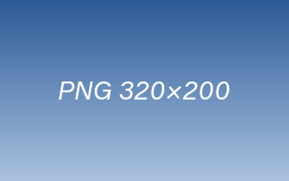
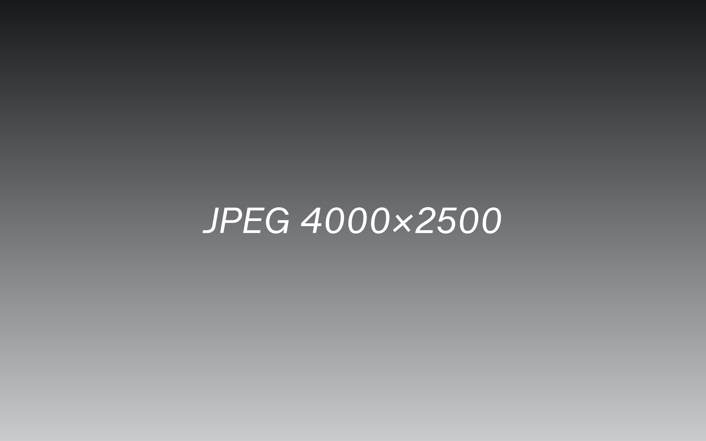
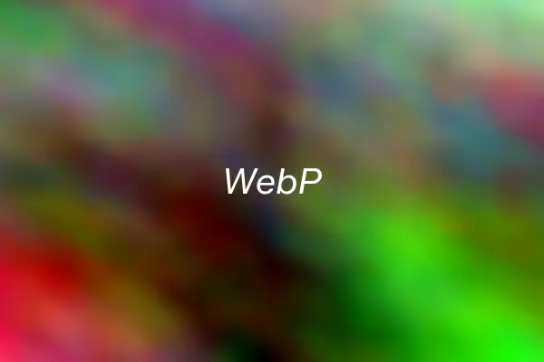

# Images

Back to [[Links]].

## Formats

PNG:

JPEG, 4000×2500, shrunk to the column:

WebP:

GIF, animated:

SVG, the Carbon mark:

## Odd shapes

Wide and short:

Narrow and tall:

## Two on one line

 

## Not shown

A file that is not there:

From the web, which is not loaded:

